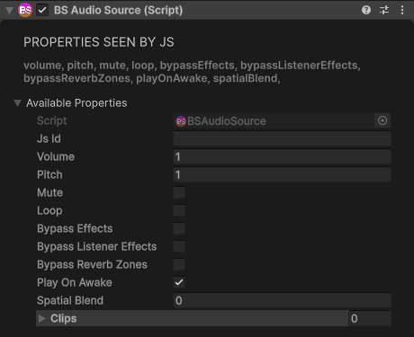

# Audio Components

Play sound in 3D space with an AudioSource or stream a playlist or audio URL in up to 5.1, and see which of the player's volume settings each source follows.

## AudioSource

Plays sound from the object. It adds a Unity Audio Source if the object doesn't have one.

| Property | Type | Default | Description |
|----------|------|---------|-------------|
| `volume` | number | 1 | Volume, 0 to 1 |
| `pitch` | number | 1 | Playback speed; above 1 is higher and faster |
| `mute` | boolean | false | Silence the source |
| `loop` | boolean | false | Loop the clip |
| `playOnAwake` | boolean | true | Play the clip when the object is enabled |
| `spatialBlend` | number | 0 | 0 = 2D (the same everywhere), 1 = 3D (from the object's position) |
| `bypassEffects` | boolean | false | Skip effects on this source |
| `bypassListenerEffects` | boolean | false | Skip the listener's global effects |
| `bypassReverbZones` | boolean | false | Skip reverb zones |

The default `spatialBlend` is 0, so a sound plays at full volume wherever the player stands. Set it to 1 for a sound that comes from the object.

<div class="docs-tabs">

```js
const audio = await obj.AddComponent(new BS.AudioSource({
    volume: 0.8,
    loop: false,
    spatialBlend: 1        // 3D: heard from the object's position
}));
audio.PlayOneShotFromUrl("https://example.com/sounds/chime.mp3");
```



</div>

**Methods:**

```js
audio.PlayOneShotFromUrl("https://example.com/sound.mp3"); // Download a sound and play it once
audio.Play();                                               // Play the Audio Source's own clip
audio.PlayOneShot(0);                                       // Play clip 0 from the component's Clips list
```

A script can only supply sound by URL, through `PlayOneShotFromUrl`. The URL has to end in `.mp3`, `.wav` or `.ogg` (a query string after it is fine); each sound is downloaded once and kept, so playing it again is instant. The Promise resolves once the sound has been downloaded and started, and rejects if the download fails.

`Play()` and `PlayOneShot(index)` play clips set in the Inspector: `Play()` the **AudioClip** of the object's Audio Source, `PlayOneShot(index)` an entry in the BS Audio Source's **Clips** list. On a component created from a script they have nothing to play. To use them, set up the object in the editor and [find it from your script](overview.md#using-objects-placed-in-the-editor):

```js
const scene = BS.Scene.GetInstance();
const bell = await scene.Find("Bell");
const bellAudio = bell.GetComponent(BS.CT.AudioSource);
bellAudio.Play();
```

When the object already has an Audio Source (it holds the clip), a BS Audio Source added in the Inspector keeps that Audio Source's settings and reads them back into its properties. `playOnAwake` takes effect the next time the object is enabled.

## Audio Stream

Plays audio from one URL, as it downloads, through one Audio Source per channel. Stereo gives you two sources you can place anywhere in your world; 5.1 gives you a speaker for every channel, and every channel stays in step with the others. You set it up in the Inspector, and page scripts can drive it too: see [From page scripts](#from-page-scripts).

Add it from **GameObject > BS > Objects > Audio Stream**, or **BS/Audio Stream** in Add Component.

| Setting | Default | Description |
|---------|---------|-------------|
| **Url** | | An `http` or `https` address: a playlist, or an audio file or stream directly |
| **Play On Enable** | on | Start when the object is enabled |
| **Loop** | off | Start again when a stream with an end reaches it. It is fetched again, not kept in memory |
| **Prebuffer Seconds** | 1 | Audio to hold before starting, and after running dry |
| **Max Channels** | Stereo | The most channels to keep: Mono, Stereo, Quad or Surround 5.1 |
| **Channels** | all ticked | One row per channel of the layout: see below |
| **Speaker Radius** | 2 | How far from the object created sources sit |
| **Source Template** | | Created sources copy this Audio Source's settings, except Ignore Listener Volume, Ignore Listener Pause and Bypass Listener Effects |

### What it plays

You give it one URL and it works out the rest from what comes back:

| | |
|---|---|
| **Playlists** | HLS master and media playlists, video-on-demand and live, and plain `.m3u` lists |
| **Containers** | MPEG-TS, fragmented MP4, Ogg, and plain ADTS, MP3, AC-3 and WAV |
| **AAC** | AAC-LC, HE-AAC and HE-AAC v2, through the operating system's decoder: see [Formats that depend on the platform](#formats-that-depend-on-the-platform) |
| **MP3** | MPEG-1, 2 and 2.5 Layer III, mono and stereo, constant and variable bitrate |
| **WAV** | 8, 16, 24 and 32-bit PCM, 32 and 64-bit float, with channel masks up to 7.1 (mixed down to 5.1) |
| **Opus** | In Ogg and fragmented MP4 |
| **AC-3** | On its own, in MPEG-TS and in fragmented MP4 |
| **E-AC-3** | The same, through the operating system's decoder: see below |

Streams with no end, such as an Icecast station, keep playing for as long as they keep sending, and so does a `.m3u` that points at one.

From a master playlist it picks the audio with the most channels within **Max Channels**, among the codecs the platform it runs on can play. It won't play anything encrypted, non-fragmented MP4, MP3 Layers I and II, or a compressed WAV such as ADPCM. When it can't play a stream, it logs one line saying why and raises **Failed**.

#### Formats that depend on the platform

MP3, WAV, Opus and AC-3 play the same everywhere. AAC and E-AC-3 are decoded by the operating system, so what plays depends on where the world runs:

| Platform | AAC | E-AC-3 |
|---|---|---|
| Windows (player and editor, 64-bit) | Up to 5.1; a 6.1 or 7.1 stream is refused | Where Windows decodes it. Some Windows installations only pass E-AC-3 through to an external receiver, and there it is refused |
| Android and Quest | Up to 7.1, mixed down to 5.1. A plain ADTS stream whose channel layout is only given inside it (channel configuration 0) is refused | Where the device has a decoder; Quest 3 has one |
| Other platforms, such as macOS and Linux | Refused | Refused |

A refused stream fails with a line naming the codec and the reason, as any other stream that can't be played does. If you need one stream for every platform, use MP3, Opus or AC-3, or offer an AAC rendition next to an E-AC-3 one in an HLS master playlist: the rendition the platform can't play is skipped. Decoders differ in level and timing, so the same E-AC-3 stream can play louder on one device than on another.

### Channels

Each channel of the layout has a row:

| Row | What happens |
|-----|--------------|
| Ticked, no Audio Source | One is created as a child, in a standard speaker position around the object |
| Ticked, your own Audio Source | It is used as it is |
| Unticked | The channel gets no source, and its audio is dropped |

Created sources sit at the ITU angles: front left and right at 30 degrees, surrounds at 110 degrees. They are 3D unless a **Source Template** says otherwise. The LFE is never spatial.

Only the channels a stream has are played: stereo into a 5.1 layout uses Front Left and Front Right. A stream with more channels than **Max Channels** is mixed down by the ITU-R BS.775 coefficients: a 7.1 stream's back pair joins the surrounds, centre and surrounds join the fronts at -3 dB, and the LFE is left out of a layout without one. The Back Left and Back Right rows are never used. A mono stream with no Center row plays through Front Left and Front Right at -3 dB.

Your own Audio Sources must keep a **Pitch** of 1 and a **Doppler Level** of 0. Each one reads the stream at its own rate, so anything else makes that channel drift away from the others, and you will see a warning.

### Status and events

**Started** fires once audio is playing, **Stopped** when it ends or `Stop()` is called, and **Failed** with the reason. In Play mode the Inspector shows the state, codec, channels, sample rate, seconds buffered and how many times the audio ran dry.

If the audio runs dry for more than half a second, all channels stop, wait for **Prebuffer Seconds** of audio, and start again together. A shorter gap is silence on every channel at once, and the stream carries on from where it had got to.

Created sources play through the app's mixer like any other sound in your world, so players' volume settings apply to them.

`Play()` fetches from the top at most every quarter of a second. A `Play()` sooner than that waits until then, and the last one wins. On a stream that is disabled or on an inactive object, `Play()` waits until it is enabled.

### From page scripts

A page script reaches a stream you placed in your world as `BS.Unity.AudioStream`. Every call returns a promise:

```js
const radio = await scene.Find("Radio");
const stream = await radio.GetComponentAsync(BS.Unity.AudioStream);
await stream.SetUrl("https://example.com/live/master.m3u8");
await stream.SetMaxChannels(BS.Unity.BSAudioStreamLayout.Surround51);

// Your own Audio Source for a channel. null goes back to a created one.
const centre = await (await scene.Find("Centre Speaker")).GetComponentAsync(BS.Unity.AudioSource);
await stream.SetChannelSource(BS.Unity.BSAudioStreamRole.Center, centre);
await stream.SetChannelEnabled(BS.Unity.BSAudioStreamRole.Lfe, false);

await stream.Play();
```

| | |
|---|---|
| **Settings** | `GetUrl`/`SetUrl`, `GetPlayOnEnable`/`SetPlayOnEnable`, `GetLoop`/`SetLoop`, `GetMaxChannels`/`SetMaxChannels`, `GetPrebufferSeconds`/`SetPrebufferSeconds` (0.1 to 10), `GetSpeakerRadius`/`SetSpeakerRadius` (0 to 1000), `GetSourceTemplate`/`SetSourceTemplate` |
| **Channels** | `GetChannelEnabled`/`SetChannelEnabled(role, on)`, `GetChannelSource`/`SetChannelSource(role, source)`, with roles from `BS.Unity.BSAudioStreamRole` |
| **Playing** | `Play()`, `Stop()` |
| **Status** | `GetState()` (one of `BS.Unity.BSAudioStreamState`), `GetCodec()`, `GetStreamChannels()`, `GetPlayingChannels()`, `GetSampleRate()`, `GetBufferedSeconds()`, `GetUnderruns()`, `GetFailureReason()` |

A change to a setting or a channel takes effect at the next `Play()`. `SetUrl` takes `http` and `https` addresses only, and an empty string clears it. An Audio Source you pass must be part of your world.

A page can't add a stream: put one in your world in Unity, with **Play On Enable** off if the page decides when it starts. **Started**, **Stopped** and **Failed** aren't sent to pages, so read `GetState()` to follow a stream.

## Volume and mixers

When a world loads in the app, every Audio Source in its scene, on inactive objects too, is routed through the app's own mixer, so each player's volume settings apply to it:

| Audio Source | Follows |
|--------------|---------|
| On an object with `music` in its name, in any capitals (`LobbyMusic`), or directly under one | **Master Volume** and **Music Volume** |
| Any other | **Master Volume** and **Gameplay Volume** |

A mixer of your own keeps working: its groups, effects and snapshots still apply, and its output goes on into the app's mixer. A mixer has one output, so it follows one of the rows above, chosen by the first Audio Source that uses it. An Audio Source on it that belongs to the other row plays straight through the app's mixer instead: it follows its own slider, but your mixer's groups and effects don't apply to it. To keep your effects on both, put music and sound effects on separate mixers. An Audio Source on a mixer group with `music` in its name counts as music too. If a mixer can't be joined to the app's, its Audio Sources play straight through the app's mixer instead.

A BS Video Player with **Route Audio Through Audio Source** on follows the same rule, and so do the sources of a BS Audio Stream. An Audio Source that a script adds after the world has loaded isn't routed, so players' volume settings don't change it.

Play mode doesn't show any of this: it plays your scene as you built it, mixer included. To hear what players hear, [visit your world](../building-in-unity/publishing.md#visiting-your-world) in the app.
