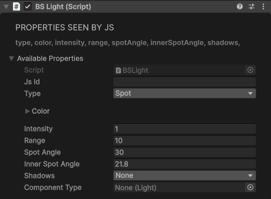
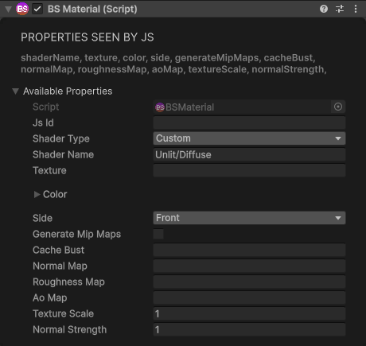
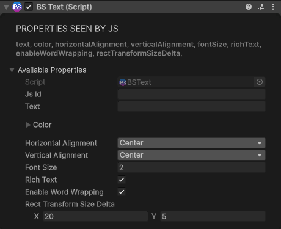
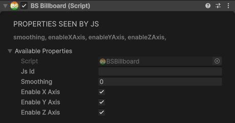
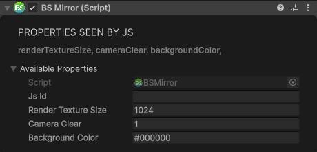
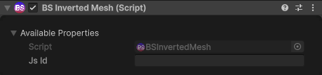
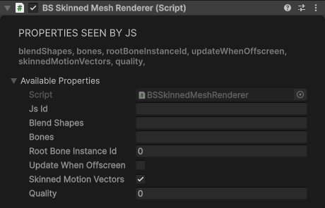

# Rendering & Visual Components

Lights, materials, text, billboards, mirrors, skinned meshes, passthrough and custom shaders: the components that change how objects look.

## Light

Adds a real-time light. It wraps a Unity Light: in the Inspector, set the values on the Light component.

| Property | Type | Default | Description |
|----------|------|---------|-------------|
| `type` | number | 0 | A `BS.LightType`: `Spot` (0), `Directional` (1) or `Point` (2) |
| `color` | Vector4 | 1, 1, 1, 1 | Colour, RGBA from 0 to 1 |
| `intensity` | number | 1 | Brightness |
| `range` | number | 10 | How far the light reaches, in metres (Point and Spot) |
| `spotAngle` | number | 30 | Cone angle in degrees (Spot) |
| `innerSpotAngle` | number | 21.8 | Inner cone angle in degrees (Spot) |
| `shadows` | number | 0 | A `BS.LightShadows`: `None` (0), `Hard` (1) or `Soft` (2) |

The default type is Spot, pointing along the object's +Z. `BS.LightType`'s other members are light types the app can't render in real time.

<div class="docs-tabs">

```js
await obj.AddComponent(new BS.Light({
    type: BS.LightType.Point,
    color: new BS.Vector4(1, 0.9, 0.8, 1),
    intensity: 2,
    range: 10,
    shadows: BS.LightShadows.None
}));
```



</div>

## Material

Applies a material/shader to the object.

<div class="docs-tabs">

```js
await obj.AddComponent(new BS.Material({
    shaderName: "Unlit/Diffuse",        // Shader name
    texture: "https://example.com/texture.png",
    color: new BS.Vector4(1, 1, 1, 1),  // RGBA tint
    side: BS.MaterialSide.Front,        // Front, Back, Double
    generateMipMaps: false,
    normalMap: "",                      // Optional maps: empty = off (URL, asset id or scheme reference)
    roughnessMap: "",                   //   read from the GREEN channel (white = rough)
    aoMap: "",                          //   read from the RED channel
    textureScale: 1,                    // UV tiling, or tiles per metre on the triplanar shaders
    normalStrength: 1
}));
```



</div>

The bundled diffuse shaders come in two families, each with an opaque and an alpha-blended twin, and
all four tint by `color` (the Transparent twins also honour its alpha):

| Shader | Mapping |
|---|---|
| `Unlit/Diffuse`, `Unlit/DiffuseTransparent` | Mesh UVs, tiled by `textureScale` |
| `Unlit/DiffuseTriplanar`, `Unlit/DiffuseTriplanarTransparent` | World-space triplanar (no UVs needed); `textureScale` = tiles per metre |

**Texture references.** `texture`, `normalMap`, `roughnessMap` and `aoMap` each take one of:

| Reference | What it loads |
|---|---|
| An absolute URL (`https://…/brick.png`) | An image downloaded from the web. `generateMipMaps` applies to it. |
| `cc0:{slug}/{map}/{size}` | A texture from the CC0 texture library. `map` is `basecolor`, `normal` or `mask`; the mask packs R = AO, G = roughness, B = metallic, so `roughnessMap` and `aoMap` can both point at it. A 256 px preview shows at once for `basecolor`, and the texture at the requested size replaces it once it has downloaded. Resolved by the app; in Play mode only when the `com.sidequest.textures-cc0` package is installed. |
| `asset_browser_world` or `asset_browser_<id>` | A live web page: your space's own page, or a BS Browser's. The material follows the page, so it stays current when the browser resizes. See [Browser Textures](../browser/textures.md). |

Anything else (a relative path, a typo) leaves the slot at the shader's default.

## Text

3D text, drawn with TextMesh Pro. It reads from the object's back (−Z), the opposite of its blue axis.

| Property | Type | Default | Description |
|----------|------|---------|-------------|
| `text` | string | "" | The text |
| `color` | Vector4 | 1, 1, 1, 1 | Colour, RGBA from 0 to 1 |
| `fontSize` | number | 2 | Font size |
| `horizontalAlignment` | number | 1 | A `BS.HorizontalAlignment`: `Left` (0), `Center` (1) or `Right` (2) |
| `verticalAlignment` | number | 1 | A `BS.VerticalAlignment`: `Top` (0), `Center` (1) or `Bottom` (2) |
| `richText` | boolean | true | Allow TextMesh Pro rich-text tags such as `<b>` and `<color>` |
| `enableWordWrapping` | boolean | true | Wrap lines at the edge of the text box |
| `rectTransformSizeDelta` | Vector2 | 20, 5 | Size of the text box, in metres |

<div class="docs-tabs">

```js
await obj.AddComponent(new BS.Text({
    text: "Hello World",
    color: new BS.Vector4(1, 1, 1, 1),
    fontSize: 2,
    horizontalAlignment: BS.HorizontalAlignment.Center,
    verticalAlignment: BS.VerticalAlignment.Center,
    richText: true,
    enableWordWrapping: true,
    rectTransformSizeDelta: new BS.Vector2(10, 5)
}));
```



</div>

## Billboard

Turns the object to face the player's view.

| Property | Type | Default | Description |
|----------|------|---------|-------------|
| `smoothing` | number | 0 | 0 turns instantly; larger values turn more smoothly |
| `enableXAxis` | boolean | true | Rotate around X |
| `enableYAxis` | boolean | true | Rotate around Y |
| `enableZAxis` | boolean | true | Rotate around Z |

<div class="docs-tabs">

```js
await obj.AddComponent(new BS.Billboard({
    smoothing: 0,
    enableXAxis: false,  // stay upright: turn around Y only
    enableYAxis: true,
    enableZAxis: false
}));
```



</div>

## Mirror

Creates a reflective mirror surface: 2.5 × 2.5 m, seen from the object's back (−Z). Scale the object to change its size.

| Property | Type | Default | Description |
|----------|------|---------|-------------|
| `renderTextureSize` | number | 1024 | Resolution of the reflection; higher is sharper and costs more |
| `cameraClear` | number | 1 | What fills the reflection behind objects: 1 = Skybox, 2 = Solid Color, 3 = Depth Only, 4 = Nothing |
| `backgroundColor` | string | "#000000" | Colour used with Solid Color, as a hex string |

<div class="docs-tabs">

```js
const mirror = await obj.AddComponent(new BS.Mirror({
    renderTextureSize: 1024,
    cameraClear: 2,
    backgroundColor: "#202030"
}));
```



</div>

**Methods:**

```js
mirror.SetCullingLayer(5);   // Show only this layer in the mirror
mirror.AddCullingLayer(6);   // Also show this layer
```

## InvertedMesh

Turns the object's mesh inside out, so you see it from inside: a sky sphere, or a room built from a box. It reverses the mesh's triangles once, when it starts. Normals aren't flipped, so it looks best with an unlit material.

<div class="docs-tabs">

```js
await obj.AddComponent(new BS.Sphere({ radius: 50 }));   // the shape first
await obj.AddComponent(new BS.InvertedMesh());
```



</div>

The object needs its mesh by the time the component starts, so add the shape first. If the shape is rebuilt later (a property changes), the new mesh isn't turned inside out.

## SkinnedMeshRenderer

Exposes a skinned mesh, such as a character in your scene, to your script, most usefully its blend shapes. It works with the Skinned Mesh Renderer already on the object and doesn't add one, so add a **BS Skinned Mesh Renderer** in the Inspector next to it and [find it from your script](overview.md#using-objects-placed-in-the-editor). The Skinned Mesh Renderer's own settings win, and are read back into the properties.

| Property | Type | Default | Description |
|----------|------|---------|-------------|
| `updateWhenOffscreen` | boolean | false | Keep skinning even when no camera sees the mesh |
| `skinnedMotionVectors` | boolean | true | Motion vectors for the skinned mesh |
| `quality` | number | 0 | Most bones per vertex: 0 = Auto, or 1, 2 or 4 |
| `blendShapes` | string | — | Read-only: the blend shapes as JSON, `{"blendShapes":[{"index":0,"name":"smile","weight":0}, …]}` |
| `bones` | string | — | Read-only: the bones as JSON, `{"bones":[{"name":…,"path":…,"instanceId":…}, …]}`, paths relative to the root bone |
| `rootBoneInstanceId` | number | — | Read-only: Unity instance ID of the root bone |

**Methods:**

<div class="docs-tabs">

```js
const scene = BS.Scene.GetInstance();
const face = await scene.Find("Face");
const smr = face.GetComponent(BS.CT.SkinnedMeshRenderer);

const smile = await smr.GetBlendShapeIndex("smile");   // -1 if there's no such shape
await smr.SetBlendShapeWeight(smile, 100);              // weights run 0 to 100
const weight = await smr.GetBlendShapeWeight(smile);   // 100
```



</div>

`blendShapes` lists the weights from when the component started; it isn't updated by `SetBlendShapeWeight`.

## Passthrough

Turns a surface into a window to the player's real room: the headset's passthrough shows through it. On any object with a mesh, choose **Add Component > BS > Passthrough**. That also puts the **BS Passthrough** material on its renderer. For a ready-made one, choose **GameObject > BS > Objects > Passthrough Box**: a 1 m box with no collider, so it's a window rather than a wall. A quad makes a window, a hole in a wall shows the room behind it, and an inverted sphere around the player (with [InvertedMesh](#invertedmesh)) makes the whole world mixed reality.

Things in front of the window still cover it, and transparent things in front of it blend over it as usual. The material's **Opacity** and **Mask (alpha)** fade the window, for soft edges. Its whole surface still counts as window, even where the mask is fully transparent: it writes depth there, and an older-style transparent shader in front of that part can let a little of the room through.

While a window is open on a headset that shows passthrough, post-processing (bloom and the like) and HDR are off for the whole world, because both would hide the window.

It's an ordinary component with nothing in the script API. To open or close a window from a script or a graph, enable or disable its object. The headset's passthrough stays on while any enabled Passthrough is in the world, and turns off about two seconds after the last one goes. Passthrough costs the headset battery and heat, so close windows nobody is looking at.

Passthrough works on standalone headsets that offer it to OpenXR apps: Quest, Steam Frame, Pico 4 Ultra and Android XR. Everywhere else the window draws its **Fallback Colour** (black unless you change it): on PC VR over Link or SteamVR, on desktop, in the editor, and in mono views such as photos, recordings, mirrors and portals.

Keep windows on your world's own layers, such as Default. The client draws the Menu, UIOnTop, AvatarOnTop and AvatarPreview layers over the world, so a window on one of those cuts through everything in front of it, the player's hands included. The Inspector warns about this.

Windows mark their pixels with stencil bit 128, so don't write that bit in your own shaders. Where it's set, the client leaves the pixel's transparency as it is: a shader that sets it outside a window can let the room show through, and one that clears it inside a window closes the window there.

## Custom shaders in VR

The headset draws both eyes in one pass: single-pass instanced rendering, or multiview on Quest. A shader has to pass the eye from its vertex program to its fragment program, or it shows in one eye only.

Shader Graph does this for you, and so do URP's own shaders, so only hand-written `.shader` files need it. Play mode on a flat screen doesn't show the problem: check custom shaders in a headset.

The numbered lines are the ones a vertex and fragment program need:

```hlsl
#pragma vertex Vertex
#pragma fragment Fragment
#pragma multi_compile_instancing

#include "Packages/com.unity.render-pipelines.universal/ShaderLibrary/Core.hlsl"

struct Attributes
{
    float4 positionOS : POSITION;
    float2 uv : TEXCOORD0;
    UNITY_VERTEX_INPUT_INSTANCE_ID                   // 1
};

struct Varyings
{
    float4 positionCS : SV_POSITION;
    float2 uv : TEXCOORD0;
    UNITY_VERTEX_OUTPUT_STEREO                       // 2
};

Varyings Vertex(Attributes input)
{
    Varyings output = (Varyings)0;
    UNITY_SETUP_INSTANCE_ID(input);                  // 3
    UNITY_INITIALIZE_VERTEX_OUTPUT_STEREO(output);   // 4
    output.positionCS = TransformObjectToHClip(input.positionOS.xyz);
    output.uv = input.uv;
    return output;
}

half4 Fragment(Varyings input) : SV_Target
{
    UNITY_SETUP_STEREO_EYE_INDEX_POST_VERTEX(input); // 5: before anything that depends on the eye
    return half4(input.uv, 0, 1);
}
```

**Screen textures.** `_CameraOpaqueTexture` and `_CameraDepthTexture` hold one slice per eye, so declaring one as a `sampler2D` reads the same eye on both sides. Include URP's declaration and use its helper, which picks the right eye (it needs step 5):

```hlsl
#include "Packages/com.unity.render-pipelines.universal/ShaderLibrary/DeclareOpaqueTexture.hlsl"

// In the fragment program:
half3 behind = SampleSceneColor(GetNormalizedScreenSpaceUV(input.positionCS));
```

For depth, include `DeclareDepthTexture.hlsl` and call `SampleSceneDepth`. For other per-eye textures of your own, use `TEXTURE2D_X` and `SAMPLE_TEXTURE2D_X`.

!> The app's Quest settings turn the opaque and depth textures off, so on Quest a shader that reads them doesn't get the scene. That goes for Shader Graph's **Scene Color** and **Scene Depth** nodes too. Effects built on them, such as refraction or soft edges against geometry, work on Windows only: give Quest a version that doesn't need them, with a [Platform Filter](../building-in-unity/platform-filter.md).

The checklist's **VR shaders** check warns about hand-written shaders that miss these steps. It reads the `.shader` file itself, so a shader that keeps its vertex program's output in an include isn't checked.
