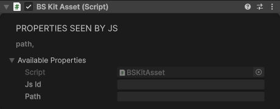
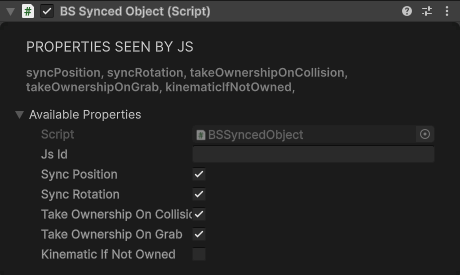
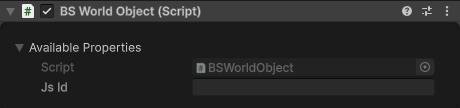
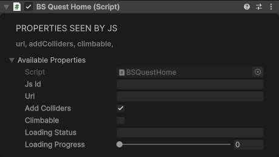
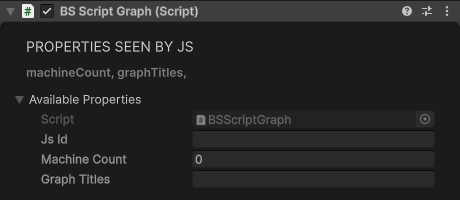
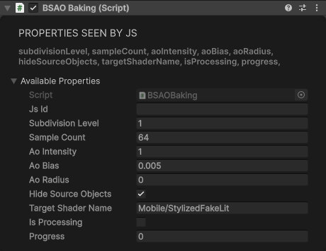

# Special Components

Kit assets, synced, spawned and world objects, platform filters, world options, host checks, Quest Home, script graphs and AO baking.

## KitAsset

Places a prefab from the app's built-in library of low-poly assets, addressed by its path in that library. The prefabs ship inside the app, so nothing is downloaded and no per-space registration is needed. The path is relative to the library's Assets root, as in the example. Changing `path` replaces the prefab.

| Property | Type | Default | Description |
|----------|------|---------|-------------|
| `path` | string | "" | Library path of the prefab |

<div class="docs-tabs">

```js
await obj.AddComponent(new BS.KitAsset({
    path: "CartoonCubeWorld/Prefabs/Props/Apple.prefab"
}));
```



</div>

In Play mode a kit asset only appears when the library package (`com.sidequest.low-poly-assets-processed`) is in your project; without it the object stays empty and the Console says the path couldn't be resolved.

## SyncedObject

Shares the object's position and rotation with every player in the space. One player owns the object at a time and everyone else's copy follows theirs. Every player's copy must have the same object id: objects placed in the editor do, while an object your script creates needs the same `networkId` on every player, set before the SyncedObject is added. [Multiplayer](../multiplayer/overview.md#synced-objects) covers ownership and movement in full.

| Property | Type | Default | Description |
|----------|------|---------|-------------|
| `syncPosition` | boolean | true | Ignored: the position is always shared |
| `syncRotation` | boolean | true | Share the rotation too |
| `takeOwnershipOnCollision` | boolean | true | Touching the object makes you its owner |
| `takeOwnershipOnGrab` | boolean | true | Grabbing the object makes you its owner until you let go |
| `kinematicIfNotOwned` | boolean | false | The object stays kinematic until someone takes ownership of it |
| `takeOwnershipOnProximity` | boolean | true | Coming close (about 0.3 m) makes you its owner, just before you touch it. Off: only a touch (`takeOwnershipOnCollision`) or a grab takes it |

The app reads these once, a frame after the object starts, so set them when you add the component.

<div class="docs-tabs">

```js
const ball = new BS.GameObject({ name: "Ball", localPosition: new BS.Vector3(0, 1.5, 2) });
await ball.SetNetworkId("ball-1");   // the same on every player, before the SyncedObject
await ball.AddComponent(new BS.Sphere({ radius: 0.2 }));
await ball.AddComponent(new BS.SphereCollider({ radius: 0.2 }));
await ball.AddComponent(new BS.Rigidbody({ mass: 1 }));
const sync = await ball.AddComponent(new BS.SyncedObject({ takeOwnershipOnCollision: true }));
```



</div>

**Methods:**

```js
sync.TakeOwnership();               // Ask to become the owner
const mine = await sync.DoIOwn();   // true if this player owns the object now
```

In SDK Play Mode on its own, `DoIOwn()` always resolves `false`; with [local multiplayer](../multiplayer/local-testing.md) it answers as the app does.

## SpawnerObject

A dispenser. The object stays where you put it, and grabbing it puts a copy of the whole object in your hand: the same mesh, children and components, thrown with physics and shared with every player in the space, including players who arrive later. Use it for cups, balls, markers, anything players should be able to take as many of as they like.

- The spawner itself is not networked. With `forceKinematic` on (the default) its Rigidbody is made kinematic, so it stays where you put it. Turn it off to leave the Rigidbody as you set it, for a spawner that falls or can be knocked over; each player then simulates their own spawner, so it can end up in different places for different players. Copies always appear where the grabbing player's spawner is, and are synced from there.
- Each copy is a [SyncedObject](#syncedobject) with its own object id, never the spawner's. If the spawner has a SyncedObject of its own, its settings decide how the copies sync; otherwise the copies get the defaults. Grabbing a copy always makes you its owner.
- A copy is removed when the player who owns it leaves.
- With `maxSpawned` copies out, spawning another removes the oldest one nobody is holding. If every copy is being held, grabbing the spawner just holds it. Two players spawning at the same moment can briefly go one over.
- The copy is in your hand at once; the other players see it a moment later, once the server has given it its id.
- Spawning needs a multiplayer room. On its own, SDK Play makes copies only you can see; with [Local Multiplayer](../multiplayer/local-testing.md) running they are shared like in the app.

| Property | Type | Default | Description |
|----------|------|---------|-------------|
| `maxSpawned` | number | 10 | How many copies of this spawner can exist at once |
| `forceKinematic` | boolean | true | Make the spawner's Rigidbody kinematic so it stays put; off leaves the Rigidbody as you set it |

The spawner needs a collider on the Grabbable layer (20), like anything else a hand picks up; the Builder's checklist warns when it has none. **GameObject > BS > Objects > Spawner Object** makes a ready-to-use one: a 0.4 m stick with a kinematic Rigidbody, `BSWorldObject`, `BSSyncedObject`, `BSGrababble` (held along its length) and `BSSpawnerObject`. Swap the stick's mesh and collider for your own object. A SyncedObject on a child of the spawner is removed from the copies, because each copy is synced as one object.

```js
const cup = new BS.GameObject({ name: "Cup" });
await cup.SetNetworkId("cup-spawner");   // the same on every player
await cup.SetLayer(20);                  // Grabbable
await cup.AddComponent(new BS.BoxCollider({ size: new BS.Vector3(0.1, 0.12, 0.1) }));
await cup.AddComponent(new BS.Rigidbody({ isKinematic: true }));
await cup.AddComponent(new BS.SpawnerObject({ maxSpawned: 10 }));
```

## PlatformFilter

Shows an object only on the platforms and in the modes you tick: PC or Android, VR or a flat screen, combined with AND (Android + VR only, for example). The platform half is settled when the space is built; the VR half on the player's device. See [Platform Filter](../building-in-unity/platform-filter.md) for the full rules.

```js
await obj.AddComponent(new BS.PlatformFilter({ includeOnDesktop: false, includeInNonVR: false })); // Quest headsets only
```

## WorldOption

Adds a button for your world to the player's radial menu. Add it with **Add Component > BS > World Option** (one per GameObject). There are two slots, and the button is there while the component is enabled. If two options want the same slot, the last one enabled shows. Set up the button in the Inspector: **Slot**, **Label** (up to 32 characters of plain text), **Icon**, and **Is Toggle** for a button that stays on or off.

To react to a press with no graph or script, wire up **On Press** in the Inspector, under **Available Properties**. It passes the toggle's state after the press.

In a script graph, **On World Option** (`Events > BS > Space`) fires on a press, and **Set World Option** (`BS > Space`) sets the toggle state.

A press happens only for the player who pressed it; send a one-shot or a synced property to share the result. Players can hide world buttons in Customize, so don't make one the only way to do something.

From a page script, add `BS.WorldOption` and listen for `world-option` on its GameObject. Read the state from the event: a press doesn't update the component's `isOn` on the page. A page script can't set the icon, so its buttons use the default world icon.

```js
const obj = new BS.GameObject("LightsOption");
await obj.AddComponent(new BS.WorldOption({ slot: 1, label: "Lights", isToggle: true }));
obj.On("world-option", (e) => console.log("Lights on:", e.detail.isOn));
```

## VerifyHost

Checks that your world is running from its own address, so a copy uploaded somewhere else doesn't carry on as yours. Add it with **GameObject > BS > Objects > Verify Host**, or **Add Component > BS > Verify Host** on any object. It's an ordinary component, so it works in a prefab too.

| Property | Default | Description |
|----------|---------|-------------|
| **Match** | Domain | How **Url** is read: Domain or Regular Expression |
| **Url** | empty | Domain: the address this world belongs at, such as `https://my-world.worldspace.host`. Only the host and any port are compared. Regular Expression: an expression run against the page's entire URL |
| **Outcome** | Teleport To Position | What happens to a player at any other address: Teleport To Position or Send To World |
| **Teleport Position** | `0, 0, 0` | Where Teleport To Position puts the player, in world space |
| **World Url** | empty | Where Send To World sends the player. Without `https://`, it's assumed |
| **Error Message** | `This world is only available at its official address.` | The error Send To World shows as the player leaves. Empty shows nothing |

It has no JavaScript API: page scripts can't add it, read it or change it, so it always runs on the values saved in your build.

Once the space has loaded, it checks where the page is running, once for each player. In the wrong place, Teleport To Position moves that player to **Teleport Position**, and Send To World shows them **Error Message** and sends them to **World Url**.

With **Match** on Regular Expression, **Url** is tested against the page's entire URL (`location.href`), so it can look at the path and query too. Start it with `^`, as in `^https://my-world\.worldspace\.host/`: without that, it can match anywhere in the URL, including a query string a copy makes up. Upper and lower case count as different.

Send To World won't send a player to the host they're already on, because they would load straight back into the same check. If **World Url** isn't an http or https address, it does nothing and shows no error, and logs a warning.

If **Url** is empty or isn't a valid expression, or the page's address can't be read, nothing happens to the player and a warning is logged. An expression that takes too long to run counts the same way. SDK Play Mode runs from localhost, so the check is skipped there, though a bad **Url** still logs its warning: visit your world once it's published to test it.

The Domain comparison is exact, except that a world's address on SideQuest's other world domain is the same world: `my-world.worldspace.host` also matches `my-world.bant.ing`, and the other way round. A visitor on any other older alias of your world's address (a previous name, or a custom domain you no longer use) counts as being at the wrong host. **Url** and **World Url** are saved in your build, so upload a new build as soon as you [change your world's address](../building-in-unity/publishing.md): until then, every visitor fails the check.

This deters copies; it can't stop them. For the strongest check, keep it on its own object at the root of the scene, with no BS components: page scripts only see objects that have them.

In a script graph, instantiate a prefab that holds the component, or use the **Verify Host** node (`BS > Space`), which runs the same check and then carries on from **Verified** or **Wrong Host**. That happens later, in a new flow, so use graph or object variables for anything you need from before the node. The node's inputs live in the graph, which a page can edit, so use the component when that matters.

## WorldObject

Marks a physics object the players' hands can hold: while a hand grabs it, the hand stops colliding with the object's colliders, so it doesn't knock the object out of its own grip. Put it on the object with the Rigidbody. You rarely need it yourself: [Grababble](vr-interaction.md#grababble) adds one, and a [GrabHandle](vr-interaction.md#grabhandle) on a Rigidbody adds one if there isn't one.

<div class="docs-tabs">

```js
await obj.AddComponent(new BS.Rigidbody({ mass: 1 }));
await obj.AddComponent(new BS.WorldObject());
```



</div>

## QuestHome

Loads a Meta Quest home environment from an APK URL.

| Property | Type | Default | Description |
|----------|------|---------|-------------|
| `url` | string | "" | URL of the Quest home APK |
| `addColliders` | boolean | true | Add colliders to opaque meshes |
| `climbable` | boolean | false | Put those colliders on the Grabbable layer (20) so surfaces can be climbed |

<div class="docs-tabs">

```js
await obj.AddComponent(new BS.QuestHome({
    url: "https://cdn.sidequestvr.com/file/167567/canyon_environment.apk",
    addColliders: true,
    climbable: false
}));
```



</div>

## ScriptGraph

Hosts Unity Visual Scripting machines on the object and mirrors a small summary to JS; see [Visual Scripting](../visual-scripting/overview.md) for editing the graphs themselves.

| Property | Type | Default | Description |
|----------|------|---------|-------------|
| `machineCount` | number | 0 | Number of script machines on the object (maintained by Unity) |
| `graphTitles` | string | "" | Comma-separated graph titles, by machine index |

<div class="docs-tabs">

```js
const graphs = await obj.AddComponent(new BS.ScriptGraph());
await graphs.CreateMachine();     // Add a machine with an empty Start/Update graph
await graphs.RemoveMachine(0);    // Remove the machine at index 0
await graphs.RefreshMachines();   // Recount machines and resync machineCount/graphTitles
```



</div>

## AOBaking

Merges child meshes and bakes ambient occlusion into vertex colors for improved visual quality with minimal runtime cost. Use this for static geometry like buildings, terrain features, or any collection of primitives that won't move.

**When to use:**
- You have multiple child primitives/meshes under a parent object
- The objects are static (won't move after baking)
- You want soft shadows/ambient occlusion without real-time lighting cost
- Building procedural environments that need better visual depth

**What it bakes:** every child (at any depth) that has both a mesh and a renderer, so give each child a shape and a [BS.Material](rendering.md#material). Children are merged per material, and each merged mesh gets a copy of its material on `targetShaderName`. The originals' renderers are hidden (with `hideSourceObjects`); their colliders keep working.

**Best Practices:**

1. **Use root parents:** When building something out of multiple primitives, always create a root parent GameObject first and add all primitives as children. This keeps the hierarchy clean and organized, and is required for AOBaking to work correctly.

2. **Bake incrementally:** Bake each object as soon as it's finished before building the next one. This ensures proper AO from nearby objects.

3. **Rebake when adding neighbors:** If you add a new object next to or intersecting with an already-baked object, rebake the existing object so it picks up occlusion from the new geometry.

4. **Build in layers:** Construct scenes in this order for best results:
   - **Background** (skyboxes, distant scenery)
   - **Ground** (terrain, floors)
   - **Large elements** (buildings, walls, major structures)
   - **Detail objects** (furniture, props, decorations)

   This layered approach ensures large occluders are in place before baking smaller objects.

<div class="docs-tabs">

```js
// Create the parent, then its children: each with a shape and a material
const building = new BS.GameObject({ name: "Building" });
const stone = new BS.Vector4(0.8, 0.78, 0.72, 1);

const wall = new BS.GameObject({ name: "Wall", parent: building });
await wall.AddComponent(new BS.Box({ width: 5, height: 3, depth: 0.2 }));
await wall.AddComponent(new BS.Material({ color: stone }));

const pillar = new BS.GameObject({ name: "Pillar", parent: building, localPosition: new BS.Vector3(2, 0, 0.5) });
await pillar.AddComponent(new BS.Cylinder({ radiusTop: 0.3, radiusBottom: 0.3, height: 3 }));
await pillar.AddComponent(new BS.Material({ color: stone }));

// Add AO baking to the parent
const aoBaker = await building.AddComponent(new BS.AOBaking({
    subdivisionLevel: 2,              // 0-3, higher = more detail
    sampleCount: 128,                 // 16-256, higher = better quality
    aoIntensity: 1.2,                 // 0-2, strength of shadows
    aoBias: 0.005,                    // Prevents self-shadowing artifacts
    aoRadius: 0,                      // 0 = auto, or set max occlusion distance
    hideSourceObjects: true,          // Hide original meshes after merge
    targetShaderName: "Mobile/StylizedFakeLit"  // Shader with vertex color support
}));

// Bake the AO (merges meshes, subdivides, raycasts for occlusion), and wait for it to finish
const baked = new Promise(resolve => building.On("object-update", () => {
    if (aoBaker.progress === 1) resolve();
}));
await aoBaker.BakeAO();
await baked;

// Later: aoBaker.Preview() merges without AO; aoBaker.Clear() restores the original meshes
```



</div>

**Properties:**

| Property | Type | Default | Description |
|----------|------|---------|-------------|
| `subdivisionLevel` | number | 1 | Subdivision iterations (0-3). Higher = more vertices for smoother AO |
| `sampleCount` | number | 64 | Ray samples per vertex (16-256). Higher = better quality, slower |
| `aoIntensity` | number | 1 | Strength of occlusion effect (0-2) |
| `aoBias` | number | 0.005 | Offset to prevent self-intersection (0.001-0.1) |
| `aoRadius` | number | 0 | Max occlusion check distance (0 = auto based on mesh size) |
| `hideSourceObjects` | boolean | true | Hide original child meshes after baking |
| `targetShaderName` | string | "Mobile/StylizedFakeLit" | Shader name to apply (must support vertex colors) |
| `isProcessing` | boolean | - | Read-only: true while baking |
| `progress` | number | - | Read-only: 0 when a bake starts, 1 when it's done (there are no steps in between) |

Values outside the ranges are clamped. The properties are read when you call `BakeAO()` or `Preview()`, so change them before baking. `isProcessing` and `progress` reach your script when a bake starts and when it ends, each time with an `object-update` event on the GameObject.

**Methods:**

| Method | Description |
|--------|-------------|
| `BakeAO()` | Start merging the child meshes, subdividing, and baking ambient occlusion. The Promise resolves once the bake has started |
| `Preview()` | Merge and subdivide without AO baking (quick preview) |
| `Clear()` | Remove generated mesh and show original child objects |
